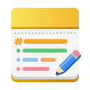

<p align="center">
  
</p>

<h1 align="center">Notav</h1>

<p align="center">Notes and a journal for GNOME and Android, kept in your Nextcloud.</p>

<p align="center">
  <a href="LICENSE"></a>
  <a href="https://github.com/AperteDev/notav/releases/latest"></a>
  <a href="https://github.com/AperteDev/notav/releases"></a>
  <a href="https://aur.archlinux.org/packages/notav-bin"></a>
  <a href="https://copr.fedorainfracloud.org/coprs/selfref/notav/"></a>
</p>

Notav is a notes app for the GNOME desktop and Android, with an Obsidian-style journal. Your notes
stay in your own Nextcloud as plain Markdown files, so the Nextcloud Notes app and Obsidian
(through the Nextcloud desktop client) can open the same folder. Notav works from a local copy
and syncs while it runs. It is the sibling of [Todav](https://github.com/AperteDev/todav), the
tasks and calendar app.

Notav is at an early stage: notes, folders, search, sync, more than one account, notes on this
device only, the journal, links between notes, favorites, the trash and versions work; tags
and links to Todav's tasks are next (see the [roadmap](docs/ROADMAP.md)).

Notav is developed in my free time. If it keeps your notes in order, you can support its
development:

<p align="center">
  <a href="https://ko-fi.com/N5E229GJPZ"></a>
  <a href="https://github.com/sponsors/SelfRef"></a>
  <a href="https://liberapay.com/SelfRef/donate"></a>
</p>

## Features

- Notes as Markdown files in a folder of your Nextcloud Files: `Notes/` by default, the
  Nextcloud Notes app's own, or any other; subfolders are folders in Notav too.
- Works offline; changes go up when the server is reachable, and changes from other devices
  come in while the window is open.
- A note edited on two devices at once is never lost: the other version is kept next to it as
  a conflict copy.
- A Markdown editor that saves as you type; the title is the file name.
- Your folders and notes as a tree, as in Obsidian; search through titles and text, ignoring
  case and accents.
- Sign-in through GNOME Online Accounts, the browser, or a login name and app password; more
  than one account, or none: notes kept on this device only.
- Settings synced between your devices.

All of what Notav does, and what it will, is listed in [FEATURES.md](docs/FEATURES.md).

## Getting started

Notav needs GNOME 49 or newer. Download a package from the
[latest release](https://github.com/AperteDev/notav/releases/latest):

<p align="center">
  <a href="https://github.com/AperteDev/notav/releases/latest"></a>
</p>

```sh
# Flatpak, on any distribution (the GNOME runtime comes from Flathub)
flatpak install --user dev.aperte.Notav.flatpak

# Ubuntu 26.04 and newer
sudo apt install ./notav_<version>_amd64.deb

# Other distributions: the same files to unpack into /
sudo tar -xzf notav-<version>-x86_64.tar.gz -C /
```

On Android (10 and newer), install `notav-<version>.apk` from the same release. With
[Obtainium](https://obtainium.imranr.dev/) it updates itself from the releases.

<p align="center">
  <a href="https://github.com/AperteDev/notav/releases/latest"></a>
  <a href="https://apps.obtainium.imranr.dev/redirect?r=obtainium://add/https://github.com/AperteDev/notav"></a>
</p>

Or [build and install](#building-and-installing) Notav from source. Then open Notav, sign in to
your Nextcloud and pick the folder your notes are in, or keep your notes on this device only.

## Translations

Notav speaks English and Polish, and follows your GNOME language. Missing your language? Ask for
it in an [issue](https://github.com/AperteDev/notav/issues), or translate it yourself (see
[CONTRIBUTING.md](docs/CONTRIBUTING.md#translations)).

## Development

### Building and installing

**Dependencies:** Rust (stable), GTK 4.14+, libadwaita 1.8+, GtkSourceView 5, WebKitGTK 6.0,
libsecret, SQLite, `blueprint-compiler`, `glib-compile-resources` (GLib) and gettext's `msgfmt`.

```sh
# The app: binary, desktop file and icons in ~/.local
make -C notav/linux install
```

A Flatpak manifest is included too: `make -C notav/linux flatpak` (needs `flatpak-builder`). For
Fedora, `notav/linux/rpm/notav.spec` builds an RPM; COPR builds it with `.copr/Makefile`, which
also works locally:

```sh
make -f .copr/Makefile srpm outdir=$PWD/target/rpm spec=$PWD/notav/linux/rpm/notav.spec
```

The `notav` command-line tool (`cargo run -p notav-cli`) syncs and edits notes for debugging.

Every push is checked and packaged by [CI](.github/workflows/ci.yml); releases are made by the
manual [Release](.github/workflows/release.yml) workflow and listed in the
[changelog](docs/CHANGELOG.md).

## License

[GPL-3.0-or-later](LICENSE)
